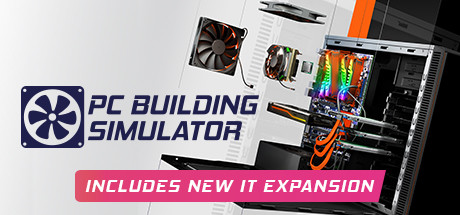

**PC Building Simulator 2 improves on the original with better graphics, more components from real manufacturers, a new career mode with competitive repair and build orders, and expanded educational content about PC hardware.**

---

## 📖 About

PC Building Simulator 2 improves on the original with better graphics, more components from real manufacturers, a new career mode with competitive repair and build orders, and expanded educational content about PC hardware.

## ⚠️ Problems Without Trainer

| Problem | Status |
|---------|--------|
| **Expanded Component Library** — Larger catalog requires knowing more compatibility relationships | ✅ Solved |
| **Timed Challenges** — Some career jobs have strict completion time requirements | ✅ Solved |
| **Client Satisfaction** — Failing to diagnose specific fault correctly results in unsatisfied clients | ✅ Solved |
| **Benchmark Requirements** — Client builds must achieve specific performance benchmarks to complete | ✅ Solved |

## ✅ Solution

The **PC Building Simulator 2 Trainer** solves all these issues by giving you complete control over the game.

## 🎯 Full Feature List

- Unlimited Resources
- God Mode / Invincibility
- Instant Skill Cooldown
- One-Hit Kill
- Freeze Game Timer
- Unlock All Items & Achievements
- Custom Speed Multiplier
- Save State Anywhere

## 🚀 Quick Start

1. **Disable Windows Defender** temporarily (trainer may trigger false positive)
2. Download the trainer from the button above
3. Launch PC Building Simulator 2
4. Run the trainer as Administrator
5. Activate desired cheats with hotkeys

## 💎 Free vs Paid

| Feature | Free | Pro |
|---------|------|-----|
| Basic God Mode | ✅ | ✅ |
| Unlimited Resources | ✅ | ✅ |
| All Advanced Cheats | ❌ | ✅ |
| Auto-Updates | ❌ | ✅ |
| Priority Support | ❌ | ✅ |

## 💻 Requirements

- Windows 10/11 (64-bit)
- PC Building Simulator 2 (any version)
- .NET Framework 4.8+
- DirectX 11+

## 🍎 macOS

macOS users can use our alternative tool:

## ⚖️ Legal

This trainer is for educational and single-player use only. Use responsibly.

---

